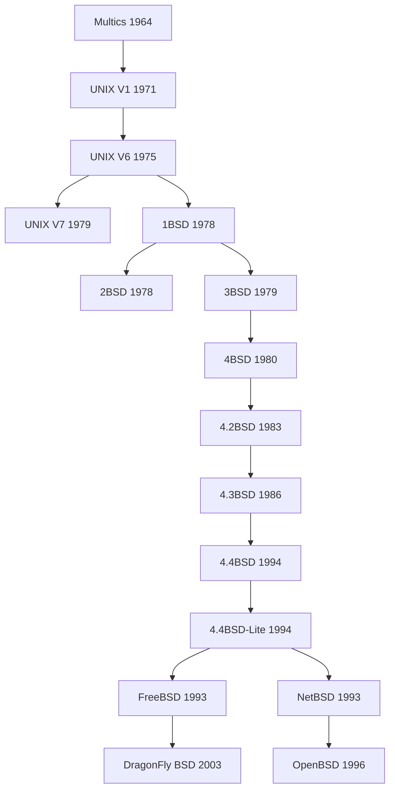
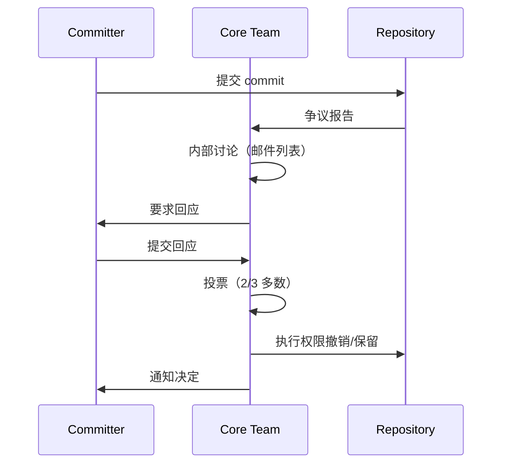

## 四、体例参照

> 本书同时参照两种史学编纂体例：
>
> - **剑桥史系列**（The Cambridge History）——提供多卷本断代、分卷主编、书目述评等结构性框架
> - **《Give Me Liberty!: An American History》**（Eric Foner）——提供“自由”组织主题、“自由之声”配对一手史料、“焦点问题”引导阅读、“自由之景”视觉专题、章节年表、关键术语、建议阅读、全球语境与包容性叙事等叙事性框架。方纳以自由的变迁含义、自由的界限、自由的可及性三个分析维度贯穿全书，本书以此三维框架移植至 BSD 史中的“软件自由”

### 4.1 剑桥史体例核心特征

| 特征 | 说明 | 本书采用方式 |
|------|------|-------------|
| **多卷本断代** | 以朝代或时代分卷，卷名标注起止年代 | 十六卷以技术时代与主题维度断代，卷名标年代或主题 |
| **分卷主编** | 各卷由领域专家主编，全书设总主编 | 各卷设虚拟分卷主编（标注研究专长） |
| **多作者分章** | 卷内各章由不同学者撰写 | AI 扮演不同视角的“作者”——内核视角、社区视角、商业视角等 |
| **书目述评** | 每卷末附详尽书目，评述相关资料和论著 | 每卷末设书目述评 + 史料讨论 |
| **不按卷序出版** | 完成哪卷先出哪卷 | 可先生成内容最充实的卷（第四卷） |
| **断代书名** | 中文版以断代名替代卷号 | 各卷同时标注卷号与断代名 |
| **拼音罗马化** | 统一罗马化系统 | 人名/术语统一格式（见第五部分） |
| **权威性与学术性** | 反映该领域研究水平和动向 | 严格引用一手史料，技术细节须准确 |
| **地图与谱系图** | 附历史地图和谱系 | 附 UNIX/BSD 谱系图、版本演进时间线图 |

### 4.2 剑桥史体例在本书中的具体应用

**卷首页格式**：

```text
剑桥 FreeBSD 史
第 X 卷：[断代名称]，[起止年代]

分卷主编：[模拟角色及研究专长]

目录
第 X 章 ......
第 X+1 章 ......
......
书目述评
索引
```

**章首格式**：

```text
第 X 章 [章节标题]

作者：[模拟角色及研究专长]

[正文]
```

**卷末书目述评格式**：

```text
书目述评

[本卷涵盖时期的核心文献评述]
[一手史料与二手研究的辨析]
[史料局限性与自反讨论]
```

### 4.3 Give Me Liberty! 体例核心特征

| 特征 | 说明 | 本书采用方式 |
|------|------|-------------|
| **自由主题组织** | 以“自由”（freedom）的意义变迁串联全书叙事 | 以“软件自由”的五重含义变迁串联 FreeBSD 全史（见 3.4 节） |
| **三维分析框架** | 自由的变迁含义、自由的界限、自由的可及性 | 软件自由的含义变迁、许可证边界扩张收缩、地理/语言/经济的可及性差异 |
| **自由之声** | 每章附“Voices of Freedom”配对一手史料选读 | 每章穿插 1-2 段“自由之声”框，引用邮件列表/commit 等原文 |
| **自由之景** | 每章设“Visions of Freedom”视觉专题 | 每章穿插 1 处“自由之景”框，以历史照片/图表/截图展示自由的视觉表达 |
| **焦点问题** | 每章设焦点问题引导阅读 | 每章开篇设 2-3 个焦点问题，指向“自由”在具体语境中的含义 |
| **章节年表** | 每章开篇附该时期关键时间线 | 每章焦点问题后附“本章年表”表格 |
| **关键术语** | 每章标示关键术语 | 每章正文末附“关键术语”表（5-10 个术语） |
| **建议阅读** | 每章末推荐延伸阅读 | 每章史料来源后附 3-5 项建议阅读 |
| **全球语境** | 将美国史置于全球语境中 | 每章至少 1 处“全球语境”段落 |
| **妥协与和解** | 自由总在枷锁中，妥协避免更大冲突 | 以 1.md“和解优于斗争”对应——BSD 史不是对抗史而是和解史 |
| **包容性叙事** | 关注被边缘化的群体 | 关注被忽视的文档贡献者、非英语社区、边缘地区用户 |
| **事件叙事** | 以事件为骨架，不堆砌概念 | 每章以具体事件/人物切入，理论融入叙事而非外加 |

### 4.4 与传统剑桥史及方纳体例的差异

本书在采用剑桥体例与方纳体例的同时，须明确以下差异：

1. **史观差异**：剑桥史系列总体秉持实证主义史学传统，追求“客观再现”；方纳以“自由”为进步叙事线索。本书以一刻哲学为指导，明确否认“客观再现”的可能性，也否认“自由”的进步性——“自由”本身即形式主义化的产物，其意义变迁不是进步而是权力再分配。
2. **自反性**：剑桥史与方纳均不反思自身的方法论局限。本书每卷末须包含自反讨论。
3. **主体性**：剑桥史以“作者”为权威。本书须承认“作者与人物的权力倒转”——Bill Joy、phk 等人物可能正在藉着本书书写他们自己的故事。
4. **自由的本质**：方纳认为自由意义虽变迁但自由本身是真实价值。本书则认为“自由”与“不自由”同为形式主义——“谁定义自由谁就限制自由”，自由本身即形式主义化的权力话语。

### 4.5 学术规范与引用体系

本书须严格遵守学术著作的引用规范与参考文献体例，采用 **Chicago Manual of Style**（芝加哥格式手册）第 17 版的注脚-参考文献制（Notes and Bibliography System），辅以数字人文适用的补充规范。

#### 4.5.1 引用格式

**脚注（Footnote）**：正文中以上标数字标注脚注序号，页底或章末集中排布脚注。脚注须包含完整书目信息。

| 史料类型 | 首次引用格式 | 后续引用格式 |
|----------|-------------|-------------|
| 邮件列表 | 作者全名，“邮件主题，”邮件列表名，日期，URL。 | 作者姓氏，“邮件主题”（简短）。 |
| commit message | 作者全名，commit message 标题，版本控制系统（Git/SVN/CVS）commit hash，日期，URL。 | 作者姓氏，commit 简短描述。 |
| 技术论文 | 作者全名，“论文标题，”期刊/会议名 卷号，期号（年份）：页码。 | 作者姓氏，“论文标题”（简短），页码。 |
| 技术图书 | 作者全名，书名（出版地：出版社，年份），页码。 | 作者姓氏，书名（简短），页码。 |
| 法律文件 | 文件全称，条款编号/文件编号，日期，URL 或存档位置。 | 文件简称，条款编号。 |
| 许可证原文 | 许可证全称，版本，§条款编号，发布机构，日期。 | 许可证简称，§条款编号。 |
| 会议演讲 | 演讲者全名，“演讲标题，”会议名，地点，日期。 | 演讲者姓氏，“演讲标题”（简短）。 |
| 官方文档 | 文档标题，版本号，发布机构，日期，URL。 | 文档简称。 |
| 个人访谈 | 受访者全名，访谈类型，访谈者姓名，日期，地点/方式。 | 受访者姓氏，访谈日期。 |
| 网络资源 | 作者全名，“页面标题，”网站名，日期，URL，访问日期。 | 作者姓氏，“页面标题”（简短）。 |

**脚注规范要点**：

- 首次引用须给完整信息；同一章内后续引用用简短格式（作者姓氏 + 简短标题 + 页码）
- 跨章引用重新给完整信息
- 禁止使用“ibid.”“op. cit.”等拉丁缩写（因其可读性差且数字版本链接不稳定）
- 邮件列表与 commit message 须标注精确日期（年月日）与归档 URL
- 法律文件须标注文件编号与签署/发布日期
- 所有 URL 须标注访问日期（accessed YYYY-MM-DD）

#### 4.5.2 参考文献体系

每卷末设 **卷末参考文献**（Bibliography），全书末设 **总参考文献**（General Bibliography）。参考文献按以下分类编排：

```text
参考文献

一、一手史料（Primary Sources）
  A. 档案与法律文件
     - FreeBSD Foundation Articles of Incorporation（2000.3.19）
     - Foundation By-Laws
     - IRS Determination Letter（2000.12.7）
     - USL v. BSDi 和解协议（1994）
     - Trademark Usage Terms and Conditions（2025.5.13）
     - Committer's Big List of Rules
     - Core Team Resolutions Document
  B. 邮件列表归档
     - freebsd-hackers / freebsd-current / freebsd-announce
     - freebsd-core / freebsd-committers
     - CVS/SVN/Git commit log
  C. 代码库
     - FreeBSD Git/SVN/CVS 历史
     - BSD SCCS 历史
  D. 许可证原文
     - BSD 2/3/4-Clause License
     - GPLv2/v3
     - CDDL
     - Apache 2.0
     - MIT License
  E. 会议与演讲
     - BSDCon / EuroBSDCon / AsiaBSDCon 录像与讲稿
     - FreeBSD Developer Summit 记录
  F. 口述史料
     - 核心人物访谈记录（标注访谈者、日期、方式、存档位置）

二、二手研究（Secondary Sources）
  A. 学术论文与专著
  B. 技术图书
  C. 新闻报道与评论
  D. 博客与技术文章
  E. 维基百科条目（须标注为辅助来源，不得作为唯一引用）

三、网络资源（Online Resources）
  - 官方网站与文档
  - 项目仓库
  - 社区论坛与 Wiki
```

**参考文献排序规则**：

- 同一分类内按作者姓氏字母序排列
- 无作者的按标题字母序排列
- 同一作者多篇按年份升序排列，同年加 a/b/c 后缀
- 中文文献按拼音字母序排列，置于英文文献之后

#### 4.5.3 史料批判规范

所有引用须遵循史料批判（Source Criticism）原则：

1. **一手史料优先**：凡存在一手史料的事件，禁止仅依赖二手叙述。一手史料包括法律文件、邮件列表原文、commit message、会议录像、官方公告等。
2. **二手史料标注**：引用二手研究时须标注“转引自”（as cited in），并注明原始一手史料的存档位置。
3. **史料可靠性分级**：
   - **A 级**（最高可靠性）：法律文件、官方注册文档、IRS 裁定书、commit log、邮件列表原文
   - **B 级**（高可靠性）：会议演讲录像/讲稿、官方文档、技术论文
   - **C 级**（中等可靠性）：技术图书、新闻报道、人物访谈
   - **D 级**（低可靠性，须交叉验证）：博客文章、论坛帖子、维基百科、社交媒体
4. **矛盾史料处理**：当一手史料与二手叙述冲突时，以一手史料为准，并在脚注中注明矛盾与取舍理由。
5. **记忆重构识别**：人物访谈与回忆录须经同时期邮件列表/commit log 交叉验证以排除记忆重构。
6. **0 信任原则（硬性约束，叠加于上述各项之上）**：对所有资料保持“0 信任”态度，即使是一手史料（法律文件、邮件列表原文、commit message、会议录像、官方公告、代码注释、会议记录、口述史等）也不因其“一手”身份而免检，必须经过考据方可采信。一手资料与二手资料在“是否需要考据”上无差异，仅在采信权重上可有差异。一手资料的考据维度包括六项：①时序一致性——所载时间与同时期其他独立来源是否冲突；②作者归属——声称的作者是否确为实际记录者或发布者，是否存在代笔、伪托、事后修订；③完整性——是否被截取、删改、合并，上下文是否完整；④独立交叉验证——与至少一项独立来源（不同作者、不同载体、不同社区）相互印证后方可采信；⑤自利偏差审查——当事人自述须经独立来源交叉验证以排除自我美化、责任转嫁、记忆偏差；⑥版本溯源——邮件列表存档须确认是否为原始归档镜像且是否存在事后编辑，代码日志须确认 commit hash 与仓库实际历史一致。考据过程须留痕：在正文注脚或附录中说明采信依据与存疑之处，不得仅凭“来源是一手”即直接采用。本原则不替代既有“三次联网复查”流程，而是叠加于其上。

### 4.6 前言与导论结构

全书须设独立的前言（Preface）与导论（Introduction），作为学术著作的必备前置结构。

#### 4.6.1 前言（Preface，约 5,000 字）

```text
前言

一、本书的写作缘起与学术定位
   - 为何需要一部 FreeBSD 通史
   - 既有 BSD 史研究的不足（McKusick 技术取向、Nikodym 社区取向、缺乏哲学反思）
   - 本书在计算机史、软件史、开源运动史中的学术定位

二、方法论声明
   - 史观：一刻哲学（详见第三部分）
   - 方法：编年体为主、纪事本末为辅、口述史补充
   - 史料：一手法律文档与代码库为主、邮件列表与会议记录为辅
   - 数字人文方法论：AI 辅助史学——本收由 AI 协助生成，须声明 AI 在史料检索、初稿撰写、事实核查中的角色与局限
   - 自反性声明：作者承认本书叙事本身即形式主义化的建构，"客观再现"是不可能的幻觉

三、学术伦理声明
   - 利益冲突声明：作者与 FreeBSD 项目、Foundation、任何商业实体的关系
   - 研究伦理：涉及在世人物的叙事须遵循"公平表征"原则——给予当事人回应机会，引用批评性言论时须同时引用当事方回应（如有）
   - 隐私保护：涉及个人通讯等非公开史料时须取得授权，邮件列表中的私人讨论不在引用范围内
   - AI 使用声明：本收由 AI 协助生成，AI 工具的版本、训练数据截止日期、使用范围须公开声明

四、致谢
   - 史料提供者、访谈对象、审稿人、技术顾问
   - FreeBSD Foundation 与社区成员的协助

五、版本说明
   - 版本号、出版日期、ISBN（预留）
   - 勘误与更新机制
   - 数字版本与开放获取声明
```

#### 4.6.2 导论（Introduction，约 10,000 字）

作为第一卷第一章之前的独立学术导论，须包含：

```text
导论：软件自由的六十年——问题、方法与史学史

一、研究问题
   - 核心问题：FreeBSD 三十年（1993-2026）的技术史如何揭示"软件自由"的意义变迁？
   - 子问题：
     ① BSDL 的宽松性如何同时造就了 FreeBSD 的广泛商业采用与其"无回馈"困境？
     ② BSD 社区的 Core Team 治理模式如何影响技术决策与社区演化？
     ③ FreeBSD 在容器化（jails）、文件系统（ZFS）、事件通知（kqueue）等领域的先驱性创新为何未能转化为市场优势？
     ④ GPLv3（2007）如何推动 BSD 化进程，这一进程的哲学意义是什么？
     ⑤ AI 时代 BSD 许可证的"无明确作者"特性如何挑战传统版权框架？

二、方法论
   - 史观框架：一刻哲学的 25 条总纲如何映射至 BSD 史
   - 叙事方法：编年体 + 纪事本末 + 人物纪传的三重交织
   - 比较方法：同时期操作系统技术发展比较的九维度框架
   - 口述史方法：核心人物访谈的记录、转录与校验规范
   - 数字人文方法：代码考古（code archaeology）——通过 Git blame/log 追溯技术决策的演化路径

三、史学史述评（Historiography）
   - 既有 BSD/UNIX 史研究的主要取向：
     ① 技术取向——McKusick & Bostic 的 CSRG 史、Quarterman 的《The UNIX Connection》
     ② 社区取向——Nikodym 的 FreeBSD 25 年史、BSD Now 播客的口述记录
     ③ 商业取向——DiBona 的《Open Sources》论文集、Weber 的《The Success of Open Source》
     ④ 法律取向——McGowan 的开源法律研究、GNU/FSF 的 GPL 史
   - 既有研究的不足：缺乏哲学反思、缺乏全球语境、缺乏自反性、缺乏对失败与争议的充分讨论
   - 本书的学术贡献定位：以一刻哲学为史观、以剑桥史+方纳体例为框架、以一手法律文档为史料底线

四、本书结构概览
   - 十六卷 346 章的整体架构
   - 卷与卷之间的逻辑关系（编年 + 专题）
   - 核心线索：UNIX → BSD → FreeBSD 主线 + 技术/社区/法律/商业四支线

五、术语说明
   - "BSD"在不同语境中的含义（4.4BSD 操作系统 vs BSD 许可证 vs BSD 社区）
   - "自由"（freedom）在本书中的五重含义（见 3.4 节）
   - "committer""Core Team""Foundation"等 FreeBSD 特有治理术语
```

### 4.7 结论章与后记结构

全书须设独立的结论章（作为第十六卷最后一章之前或之后的学术结论）与后记。

#### 4.7.1 结论章（Conclusion，约 8,000 字）

```text
结论：形式主义化的非存在——FreeBSD 史的理论反思

一、研究发现综述
   - 回答导论中提出的研究问题
   - FreeBSD 三十年技术史的核心发现

二、理论贡献
   - 对"软件自由"概念史的贡献：自由的五重含义及其形式主义性质
   - 对开源运动史的贡献：BSDL vs GPL 的结构性差异如何塑造不同的商业生态
   - 对计算机史方法论的贡献：一手法律文档作为史料的可行性
   - 对历史哲学的贡献：一刻哲学在技术史中的适用性验证

三、研究局限
   - 史料局限：部分关键决策（如 Core Team 内部讨论）可能永远无法公开
   - 方法论局限：AI 辅助史学的事实核查仍需人工复核
   - 史观局限：一刻哲学的虚无化风险可能导致"一切皆建构"的相对主义
   - 语言局限：本书以中文撰写，非英语社区的史料覆盖可能不充分

四、未来研究方向
   - 口述史系统化：对在世核心人物的系统性访谈计划
   - 比较史研究：FreeBSD 与 Linux/Solaris/ illumos 的深度比较史
   - 全球社区史：非英语区域 BSD 社区的深入田野调查
   - AI 时代的史学方法论：LLM 辅助史料挖掘与交叉验证的规范化

五、自反性结语
   - 本书本身即形式主义化的非存在——这部 FreeBSD 史是否也是权力话语的再生产？
   - 作者承认本书的有限性，在有限性中仍然选择书写——这是一刻哲学的根本姿态
```

#### 4.7.2 后记（Epilogue，约 2,000 字）

```text
后记

- 写作过程中的个人反思
- 对 FreeBSD 社区的致敬
- 本书的开放性——欢迎社区补充与勘误
```

### 4.8 附录与索引体系

全书原设附录 A-G，现均已合并入正文相应章节，不再保留独立附录体系。三重索引与术语表仍作为学术著作的标准后置结构保留。

#### 4.8.1 附录合并入正文的映射

原附录内容已按以下映射合并入正文相应章节：

```text
原附录 A：FreeBSD Foundation 法律文件汇编
   → 合并入第 40 章 FreeBSD Foundation 作为子节
   - Articles of Incorporation（全文）
   - By-Laws（全文）
   - IRS Determination Letter（2000.12.7，全文）
   - Trademark Usage Terms and Conditions（2025.5.13 最新版，全文）
   - Resolutions Document（摘要）

原附录 B：BSD 许可证文本汇编
   → 合并入第 134 章 BSD 许可证的哲学作为子节
   - BSD 2-Clause "Simplified" License（全文）
   - BSD 3-Clause "New" License（全文）
   - BSD 4-Clause "Original" License（全文）
   - 与 GPLv2/v3、CDDL、Apache 2.0、MIT 的条款对照表

原附录 C：Core Team Alumni 完整名单（1992-2022）
   → 已合并入第 42 章 FreeBSD 6.x：回归稳定 之 42.6.2 Core Team Alumni 名单子节
   - 历届 Core Team 成员名单
   - Development Team Alumni 名单
   - 各成员任期与主要贡献领域

原附录 D：committer 权限变动完整记录
   → 已分布于全书各章的"committer 权限记录"子节，每章按时期记录
   - 所有公开撤销记录（Theo de Raadt 1994、Matt Dillon 2003、Steve G. Kargl 2015 等）
   - 自动失效记录（依据"18 个月不活跃"条款）
   - 自愿退役记录

原附录 E：UNIX/BSD 谱系图
   → 合并入第 7 章 操作系统的谱系 作为子节
   - 从 Multics 到 FreeBSD 14+ 的完整版本谱系
   - 各 BSD 分支（FreeBSD/NetBSD/OpenBSD/DragonFly BSD）的分立与交叉

原附录 F：开源名词归属考证
   → 合并入相关章节叙事（第 21 章 USL 诉讼、第 32 章 4.4BSD-Lite 等），考证内容作为子节穿插
   - 详见操作手册 10-appendix-attribution.md 的考证内容

原附录 G：缩略语表
   → 合并入术语表（glossary），不再单列
   - 操作系统名称：BSD、UNIX、Linux、Solaris、illumos、Darwin、Android
   - 技术术语：SMP、VM、VFS、FFS、UFS、ZFS、DTrace、BPF、MAC、GEOM、ULE
   - 社区术语：Core Team、committer、Foundation、CSRG
   - 法律术语：BSDL、GPL、CDDL、IRS 501(c)(3)、Trademark
   - 网络协议：TCP/IP、DNS、HTTP、TLS、SSH
```

#### 4.8.2 索引体系

全书须设三重索引：

**1. 人名索引（Index of Names）**

```text
人名索引

格式：姓名（生卒年），页码
例：McKusick, Marshall Kirk（1963—），123, 156, 189, 234
例：Joy, William（1954—），45, 67, 89
例：de Raadt, Theo（1968—），112, 145
例：Kamp, Poul-Henning（1966—），78, 134
```

**2. 主题索引（Index of Subjects）**

```text
主题索引

格式：主题词，页码（主条目加粗）
例：BSD 许可证，**45**, 67, 89, 123, 156
例：BSD 化（去 GPL），**189**, 190, 191, 192
例：USL 诉讼，**112**, 113, 114
例：Core Team 治理，**78**, 79, 134, 145
例：jails 容器技术，**89**, 90, 134
例：ZFS 文件系统，**156**, 157, 189
```

**3. 技术索引（Index of Technical Terms）**

```text
技术索引

格式：技术术语（首次出现章节），页码
例：SMPng（第 41 章），**114**, 115, 134
例：kqueue/kevent（第 39 章），**112**, 134
例：ULE 调度器（第 41 章），**114**, 118, 134
例：soft updates（第 37 章），**109**, 134
例：GEOM 框架（第 41 章），**114**
例：MAC 框架（第 41 章），**114**, 134
```

**索引编制规范**：

- 页码以最终排版页码为准（AI 生成阶段用章节号 + 小节号替代）
- 主条目（首次定义或详细讨论）页码加粗
- “参见”（see also）交叉引用须双向标注
- 技术术语首次出现处标注（定义）标记
- 人物别名/常用名/账号名均须建立“参见”条目

#### 4.8.3 术语表（Glossary）

全书须设独立术语表，收录全书出现的 FreeBSD/BSD 专有术语与技术概念：

```text
术语表

格式：术语（英文原名）——释义
例：BSD 许可证（BSD License）——一类宽松的开源软件许可证，允许自由使用、修改、分发及闭源衍生，不强制回馈代码。分为 2-Clause、3-Clause、4-Clause 三个主要版本。
例：committer——FreeBSD 项目中拥有直接向代码仓库提交修改权限的开发者，由 Core Team 依据技术贡献与社区信任授予。
例：Core Team——FreeBSD 项目的最高治理机构，由活跃 committer 选举产生，负责技术方向决策与社区治理。
例：jails——FreeBSD 4.0（2000.3）引入的操作系统级虚拟化技术，通过 chroot 进化实现进程/文件系统/网络的隔离，比 Linux 容器早约 7-13 年。
例：BSD 化（BSD-ification）——FreeBSD 社区系统性替换 GPL 许可证组件为 BSD 许可证替代品的工程实践，被称为"自由之路"。
```

### 4.9 方法论声明与数字人文方法论

本书由 AI 协助生成，是一部 FreeBSD 通史，须设独立的方法论声明，公开交代研究方法、AI 辅助的角色与局限、事实核查协议与同行评议模拟机制。

#### 4.9.1 研究方法论

本书采用以下研究方法的组合：

| 方法 | 说明 | 在本书中的应用 |
|------|------|---------------|
| **编年体叙事** | 按时间顺序组织历史叙事 | 全书十六卷按技术时代断代，卷内各章按时间排列 |
| **纪事本末体** | 以重大事件为中心组织叙事 | USL 诉讼、GCC→Clang 迁移、Core Team 选举等重大事件独立成节 |
| **口述史** | 通过访谈收集当事人回忆 | 核心人物访谈记录（须与邮件列表/commit log 交叉验证，警惕记忆重构） |
| **代码考古** | 通过版本控制系统追溯技术决策演化 | Git blame/log、SVN log、CVS log 追溯关键 commit 的决策过程与讨论 |
| **比较史学** | 将 FreeBSD 与同期操作系统横向比较 | 每章设“同时操作系统技术发展比较”小节，九维度技术比较 |
| **概念史** | 追溯核心概念的语义变迁 | "软件自由"的五重含义变迁（3.4 节）、“BSD 化”的概念演化 |
| **法律文献分析** | 以法律文件为史料分析制度变迁 | Foundation 章程、IRS 裁定书、商标条款、许可证文本的系统分析 |
| **数字人文** | 运用 computational 方法辅助史学研究 | AI 辅助史料检索、文本挖掘、交叉验证、时间线可视化 |

#### 4.9.2 AI 辅助史学方法论

本书由 AI（大语言模型）协助生成，须公开声明 AI 在研究流程中的角色与局限：

**AI 的角色**：

1. **史料检索辅助**：AI 协助从邮件列表归档、代码仓库、官方文档中检索相关史料，提高史料发现效率。
2. **初稿撰写**：AI 根据史料与写作模板生成章节初稿，由人类作者审阅、修改与定稿。
3. **事实核查辅助**：AI 协助交叉验证版本号、日期、人名等技术细节，标注可能的错误。
4. **文本规范化**：AI 协助统一格式、标点、术语与引用规范。
5. **多语言史料处理**：AI 协助翻译与理解非英语史料（日文、中文、俄文等区域社区史料）。

**AI 的局限**：

1. **幻觉风险**：AI 可能生成看似合理但实际不存在的“事实”（hallucination），如虚构的人名、日期、commit hash 或邮件列表引用。所有 AI 生成的技术细节须经人工与一手史料交叉验证。
2. **训练数据截止**：AI 的训练数据有截止日期，2024 年以后的事件可能信息不完整或过时，须以最新一手史料为准。
3. **语境理解局限**：AI 可能误读技术讨论的语境，如将讽刺性邮件理解为字面意思，或将实验性代码视为生产功能。
4. **叙事偏见**：AI 的训练数据可能包含对某些社区或个人的偏见，须在审阅时识别并修正。
5. **缺乏原始判断**：AI 无法进行独立的史学判断，所有史观选择、史料取舍与叙事结构须由人类作者决定。

**AI 幻觉防护协议**：

- **三重验证原则**：所有关键事实（人名、日期、版本号、法律条款）须经至少三个独立来源验证，其中至少一个须为 A 级或 B 级史料。
- **commit hash 验证**：引用 commit 时须提供可验证的 hash 值与仓库 URL，读者可自行验证。
- **邮件列表验证**：引用邮件列表时须提供归档 URL 与精确日期，读者可自行检索。
- **法律文件验证**：引用法律文件时须提供文件编号或注册编号，读者可向相关机构验证。
- **“存疑”标注**：AI 无法验证的事实须在脚注中标注“存疑，待人工核查”，不得作为确定事实呈现。

#### 4.9.3 代码考古方法

代码考古（Code Archaeology）是本书的特色研究方法，通过版本控制系统的历史记录追溯技术决策的演化路径：

1. **Git blame 分析**：对关键代码行执行 `git blame` 追溯最后修改者、修改日期与 commit message，还原技术决策的具体时刻。
2. **Git log 考古**：对关键文件或目录执行 `git log --follow --patch` 追溯完整修改历史，还原技术演化的因果链条。
3. **commit message 分析**：commit message 是开发者决策的直接记录，须作为一手史料引用（B 级可靠性）。引用格式：`作者全名，commit message 标题，commit hash，日期，URL`。
4. **分支与合并分析**：通过 `git log --graph` 分析分支的创建、合并与废弃，还原开发流程的演化。
5. **代码迁移追溯**：对从其他项目迁移的代码（如 ZFS 从 illumos 移植、mandoc 从 OpenBSD 移植），须追溯原始项目的 commit 历史，还原技术决策的完整脉络。

**代码考古的局限**：

- **CVS/SVN 历史不完整**：FreeBSD 1993-2008 年使用 CVS，2008-2021 年使用 SVN，2021 年迁移至 Git。CVS/SVN 时代的历史可能因迁移而部分丢失。
- **commit message 质量参差**：并非所有 commit message 都详细记录决策理由，部分 commit message 可能过于简略。
- **代码与讨论分离**：技术决策的讨论通常发生在邮件列表而非 commit message 中，须将 commit 与邮件列表讨论交叉引用。

#### 4.9.4 口述史方法

对在世核心人物的口述史访谈须遵循以下规范：

1. **访谈授权**：访谈前须取得受访者的书面授权，明确访谈内容的引用范围与公开发布条件。
2. **录音与转录**：访谈须录音并完整转录，转录稿须经受访者审阅确认。
3. **交叉验证**：访谈内容须与同时期邮件列表、commit log、会议记录交叉验证，识别记忆重构与事后合理化。
4. **记忆重构识别**：人物回忆中的时间、细节可能因记忆重构而不准确，须以一手史料为准并在脚注中注明差异。
5. **公平表征**：访谈中涉及第三方的言论须给予当事方回应机会。
6. **存档**：访谈录音、转录稿与授权书须妥善存档，标注存档位置以供后续研究者查阅。

#### 4.9.5 同行评议模拟

本书作为 AI 协助生成的学术著作，须模拟同行评议（Peer Review）机制：

1. **内部审稿**：每章生成后须经过“内部审稿”流程——AI 以“审稿人”角色重新审阅全章，从技术准确性、史料可靠性、叙事连贯性、史观一致性四个维度提出修改意见。
2. **技术顾问审阅**：关键技术章节（如内核架构、ZFS、DTrace、安全机制）须模拟“技术顾问审阅”，由具备相应领域知识的 AI 角色审阅技术细节的准确性。
3. **社区公开评审**：本书的部分章节可提交 FreeBSD 社区公开评审，收集社区成员的反馈与补充。
4. **勘误机制**：本书发布后须建立勘误机制，读者可通过指定渠道提交勘误建议，经审核后纳入下一版本。
5. **版本控制**：本书自身须使用版本控制系统管理，每次修改须记录修改理由、修改内容与审阅状态。

### 4.10 GitBook 格式规范

本书采用 **GitBook** 兼容的 Markdown 格式编写与发布。GitBook 是基于 Markdown 的电子书出版平台，支持多级目录、交叉引用、提示框、选项卡、图表等扩展功能。全书须遵循以下 GitBook 格式规范。

#### 4.10.1 文件组织结构

全书按 GitBook 标准目录结构组织，每章一个 `.md` 文件，每卷一个文件夹：

```text
freebsd-history/
├── book.json                      # GitBook 配置文件
├── README.md                      # 首页（前言摘要与全书导引）
├── SUMMARY.md                     # 目录文件（GitBook 必需）
├── assets/                        # 静态资源
│   ├── images/                    # 图片（照片、截图、谱系图）
│   ├── diagrams/                  # Mermaid 源文件
│   └── attachments/               # 附件（法律文件 PDF 等）
├── front-matter/                  # 前置部分
│   ├── preface.md                 # 前言
│   └── introduction.md            # 导论
├── part-1/                        # 第一卷
│   ├── README.md                  # 卷首页（卷头说明）
│   ├── chapter-01.md              # 第 1 章
│   ├── chapter-02.md              # 第 2 章
│   └── ...
├── part-2/                        # 第二卷
│   ├── README.md
│   ├── chapter-08.md
│   └── ...
├── ...                            # 第三至第十六卷
├── back-matter/                   # 后置部分
│   ├── conclusion.md              # 结论章
│   ├── epilogue.md                # 后记
│   ├── glossary.md                # 术语表（含原附录 G 缩略语表内容）
│   ├── index-names.md             # 人名索引
│   ├── index-subjects.md          # 主题索引
│   ├── index-technical.md         # 技术索引
│   └── bibliography.md            # 总参考文献
└── .gitbook.yaml                  # GitBook CLI 配置（可选）
```

**文件命名规范**：

- 文件名全小写，连字符分隔：`chapter-01.md`、`glossary.md`
- 卷文件夹用 `part-N` 格式：`part-1`、`part-2`
- 每卷的 `README.md` 为卷首页，含卷头说明（时代背景、体例说明、字数统计）
- 图片文件名含章号与序号：`fig-05-01-unix-tree.png`（第 5 章第 1 张图）

#### 4.10.2 SUMMARY.md 目录规范

`SUMMARY.md` 是 GitBook 的核心目录文件，定义全书页面层级与导航结构：

<!-- 4.10.2 SUMMARY.md 目录示例已收敛至 05-卷册大纲/SUMMARY.md（原 directory/00-index.md 与 05-卷册大纲/00-GitBook目录/ 均已删除） -->

**SUMMARY.md 规范要点**：

- 每条用 `- [标题](文件路径)` 格式
- 卷标题指向该卷的 `README.md`
- 章标题指向该章的 `.md` 文件
- 缩进表示层级关系（卷 > 章 > 节，但节通常不列入 SUMMARY，仅在章文件内用标题表示）
- SUMMARY.md 须与实际文件一一对应，禁止列出不存在的文件

#### 4.10.3 YAML Front Matter

每个 `.md` 文件开头可设 YAML Front Matter，定义页面元数据：

```yaml
---
title: "第 5 章 Bell Labs 的黄金时代"
description: "1975-1978 年 UNIX V6/V7 的技术成熟与学术传播"
part: 1
chapter: 5
date-range: "1975-1978"
word-count: 18000
keywords:
  - UNIX V6
  - UNIX V7
  - Bell Labs
  - pipes
  - Bourne Shell
---
```

**Front Matter 规范要点**：

- `title`：页面标题（与 SUMMARY.md 中的标题一致）
- `description`：页面描述（用于 SEO 与 GitBook 预览）
- `part`：所属卷号
- `chapter`：章号
- `date-range`：本章覆盖的时间范围
- `word-count`：本章字数
- `keywords`：关键词列表（用于搜索与索引）

#### 4.10.4 GitBook 提示框（Hint Blocks）

GitBook 支持 `` 语法创建提示框，用于强调重要信息。本书须使用以下提示框类型：

**信息框（info）——用于技术注解、背景知识**：

```markdown

**技术注解：soft updates**

soft updates 是 McKusick 为 UFS 设计的元数据一致性保护机制...

```

**警告框（warning）——用于法律警示、版权注意**：

```markdown

**法律注意**

BSD Daemon 商标由 FreeBSD Foundation 持有，使用须遵守 Trademark Usage Terms and Conditions（2025.5.13 最新版）。

```

**成功框（success）——用于自由之声、正面成就**：

```markdown

**自由之声**

> "BSD 许可证的最大优势在于它不限制你做什么。"
> ——Kirk McKusick，BSDCan 2005 演讲

```

**危险框（danger）——用于权限撤销、社区冲突、争议事件**：

```markdown

**committer 权限撤销记录**

2003 年 X 月 X 日，Core Team 以 2/3 多数投票决定撤销 Matt Dillon 的 commit 权限...

```

**提示框使用规范**：

- 每章至少使用 2 个提示框（技术注解用 info，自由之声用 success）
- 权限撤销、法律诉讼、社区冲突等负面事件须用 danger 框
- 法律文件引用与版权注意须用 warning 框
- 提示框内容须简洁（200-500 字），详细内容在正文中展开
- 禁止用提示框替代正文段落，提示框仅用于强调与补充

#### 4.10.5 选项卡（Tabs）

GitBook 支持选项卡语法，用于并列内容的切换展示。本书在以下场景使用选项卡：

**同时期操作系统比较——多系统选项卡**：

```markdown


| 内核架构 | 宏内核 |
|----------|--------|
| 文件系统 | UFS/FFS + ZFS |
| 网络栈 | BSD TCP/IP（mbuf） |
| 调度器 | ULE |
| 许可证 | BSDL |



| 内核架构 | 宏内核 |
|----------|--------|
| 文件系统 | ext4 / Btrfs |
| 网络栈 | Linux TCP/IP（sk_buff） |
| 调度器 | CFS |
| 许可证 | GPLv2 |



| 内核架构 | 混合内核 |
|----------|--------|
| 文件系统 | NTFS |
| 网络栈 | Winsock / NDIS |
| 调度器 | 优先级驱动 |
| 许可证 | 专有 |



| 内核架构 | 宏内核（SVR4） |
|----------|--------|
| 文件系统 | ZFS |
| 网络栈 | Streams |
| 调度器 | 多级反馈队列 |
| 许可证 | CDDL |


```

**许可证对比——多版本选项卡**：

```markdown


Copyright (c) YYYY, Author. All rights reserved.
...



Copyright (c) YYYY, Author. All rights reserved.
...



Copyright (c) YYYY, Author. All rights reserved.
...


```

#### 4.10.6 交叉引用（Page References）

GitBook 支持 `` 语法进行页面间交叉引用：

```markdown
GCC → Clang/LLVM 的迁移历程详见 [第 46 章](part-5/chapter-46.md)。

Git 版本控制迁移的详细记录参见 。

BSD 化的哲学意义参见 。
```

**交叉引用规范**：

- 优先使用标准 Markdown 链接 `[文本](相对路径)` 格式
- 重要交叉引用可用 `` 格式（GitBook 会渲染为页面卡片）
- 章节内引用用锚点链接 `[文本](#anchor)` 格式
- 禁止使用页码引用（GitBook 为流式排版，无固定页码）

#### 4.10.7 Mermaid 图表

GitBook 支持 Mermaid 语法绘制流程图、时序图、甘特图等。本书须使用 Mermaid 绘制以下图表：

**UNIX/BSD 谱系图（flowchart）**：

```markdown

```

**版本发布时间线（gantt）**：

```markdown
```mermaid
gantt
    title FreeBSD 主要版本发布时间线
    dateFormat YYYY-MM
    section 早期
    FreeBSD 1.0    :1993-11
    FreeBSD 2.0    :1995-01
    FreeBSD 3.0    :1998-10
    section 成熟期
    FreeBSD 4.0    :2000-03
    FreeBSD 5.0    :2003-01
    FreeBSD 6.0    :2005-11
    section 现代期
    FreeBSD 7.0    :2008-02
    FreeBSD 8.0    :2009-11
    FreeBSD 9.0    :2012-01
    FreeBSD 10.0   :2014-01
    FreeBSD 11.0   :2016-10
    FreeBSD 12.0   :2018-12
    FreeBSD 13.0   :2021-04
    FreeBSD 14.0   :2023-11
```
```

**Core Team 治理决策流程（sequenceDiagram）**：

```markdown

```

**Mermaid 使用规范**：

- 谱系图、时间线、决策流程须用 Mermaid 绘制，不使用外部图片
- Mermaid 代码块须标注 `mermaid` 语言标签
- 复杂图表可拆分为多个简单图表
- Mermaid 图表须有标题（`title` 字段）
- 节点文本须简洁（不超过 15 字符）

#### 4.10.8 代码块规范

GitBook 代码块支持行号、高亮、文件名标注：

```markdown
    ```c:line-numbers:title=/sys/kern/sched_ule.c
    /*
     * ULE 调度器——FreeBSD 5.x 引入，7.1 起默认
     * 作者：Jeff Roberson
     */
    static void
    sched_choose(struct thread *td)
    {
        struct tdq *tdq;
        /* 选择当前 CPU 的调度队列 */
        tdq = TDQ_SELF();
        ...
    }
    ```
```

**代码块规范**：

- 代码块须标注语言标签（`c`、`python`、`bash`、`sql`、`diff` 等）
- 关键代码须启用行号（`:line-numbers`）
- 引用源码文件须标注文件路径（`:title=路径`）
- 代码块内的注释须翻译为中文（遵循用户规则）
- `fstab` 内容不翻译
- 命令行示例用 `bash` 标签
- diff 对比用 `diff` 标签

#### 4.10.9 脚注规范

GitBook 原生支持 Markdown 脚注语法：

```markdown
正文中引用处标注脚注引用[^1]。

...

[^1]: 脚注内容。作者全名，"邮件主题，"邮件列表名，日期，URL，访问日期 YYYY-MM-DD。
```

**脚注规范**：

- 脚注引用用 `[^N]` 格式，N 为章内序号（从 1 开始）
- 脚注定义放在章末（GitBook 会自动渲染为页底或章末脚注）
- 脚注内容须符合 Chicago Manual of Style 第 17 版格式（详见 4.5.1 节）
- 长脚注（超过 5 行）可考虑改为正文括号注或独立段落

#### 4.10.10 book.json 配置

全书须设 `book.json` 配置文件，定义 GitBook 的行为与插件：

```json
{
  "title": "给我自由—一部 BSD 史",
  "author": "AI 辅助生成",
  "description": "从 UNIX 起源到 FreeBSD 16.x 的六十年技术史",
  "language": "zh-hans",
  "gitbook": ">= 3.2.0",
  "root": ".",
  "structure": {
    "readme": "README.md",
    "summary": "SUMMARY.md",
    "glossary": "back-matter/glossary.md"
  },
  "plugins": [
    "hint",
    "tabs",
    "mermaid-v8",
    "page-toc-button",
    "search-pro",
    "sharing-plus",
    "fontsettings",
    "back-to-top-button",
    "chapter-fold",
    "code-sections",
    "footnote"
  ],
  "pluginsConfig": {
    "fontsettings": {
      "theme": "white",
      "family": "serif",
      "size": 2
    },
    "sharing": {
      "facebook": true,
      "twitter": true,
      "github": true
    }
  },
  "variables": {
    "bookTitle": "给我自由—一部 BSD 史",
    "author": "AI 辅助生成"
  }
}
```

**插件说明**：

- `hint`：提示框（info/warning/success/danger）
- `tabs`：选项卡
- `mermaid-v8`：Mermaid 图表渲染
- `page-toc-button`：页面内目录浮动按钮
- `search-pro`：全文搜索
- `sharing-plus`：社交分享
- `fontsettings`：字体设置（正文用衬线体 serif）
- `back-to-top-button`：返回顶部按钮
- `chapter-fold`：目录折叠展开
- `code-sections`：代码块折叠
- `footnote`：脚注支持

---


## 卷头主体声明体例（2026-10-06 立，119d ★8／★9）

- **目的**：使每卷的叙述单位（历史主体）在目录页卷首即可辨认，并为机检提供稳定锚（第七件 R 组、第十二件夹具）。
- **载体**：内容源 `data/outline.txt` 的 `! 卷分工注`（渲染为 `<p class="vol-note">`）。**每卷仅允许一条**——已有分工注者以“；”续接，无者新插于卷导言之后（装配器对同卷两条 `!` 直接 exit）。
- **六组句式**（唯一真值表，改卷或新增卷须同批维护）：
  1. **分支编年卷**（25／28／31／34）：`〔主体声明〕本卷叙述单位为操作系统（制品），变迁单位＝版本序列；项目、法人与职位事件另见本分支文化卷与第四十五、四十六卷（制度卷）`
  2. **分支技术专题卷**（26／29／32／35）：`〔主体声明〕本卷叙述单位为操作系统之技术物；项目决策与治理制度另见第四十五、四十六卷`
  3. **分支文化卷**（27／30／33／36）：`〔主体声明〕本卷叙述单位为项目（共同体），变迁单位＝共同体与协作制度；制品的版本编年见本分支编年卷`
  4. **横向比较卷**（38／39）：`〔主体声明〕本卷对象为四分支之横向比较；主体四方并列，不设单一主体`
  5. **制度卷**（50／51）：`〔主体声明〕本卷叙述单位为法人（基金会）与授权结构（团队与职位）；项目事件面见各分支文化卷`
  6. **外部对象卷**（8／18／20／22／23／24／40／41／42／43／45／46／47／48／52／57）：`〔主体声明〕本卷叙述单位在 BSD 之外（<该卷对象>）；与 BSD 各主体之交接见相关分工注`
- **约束**：①不得写入卷题或卷导言（卷题属书名系统，卷导言属叙述）；②声明内禁用 Markdown 标记（`**` 等会字面渲染，第七件 Q 组会拦）；③引号用中文弯引号，禁直角引号（`guard_source_chars` 会拦）。
